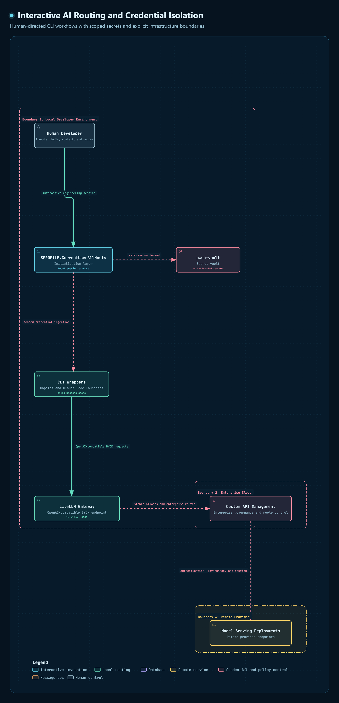
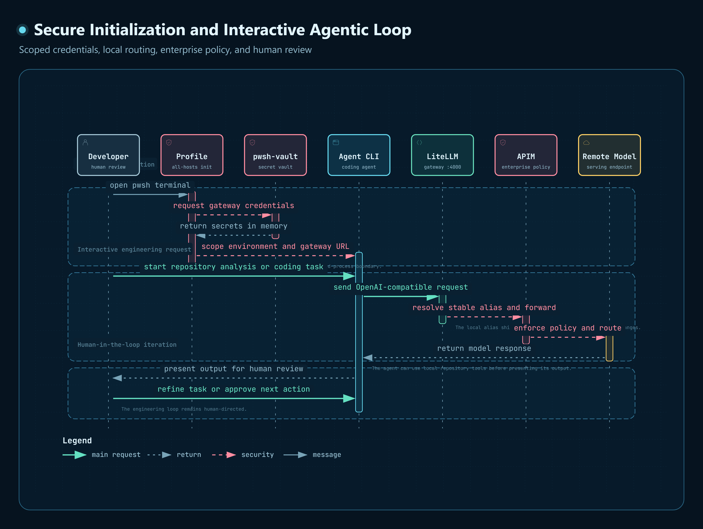
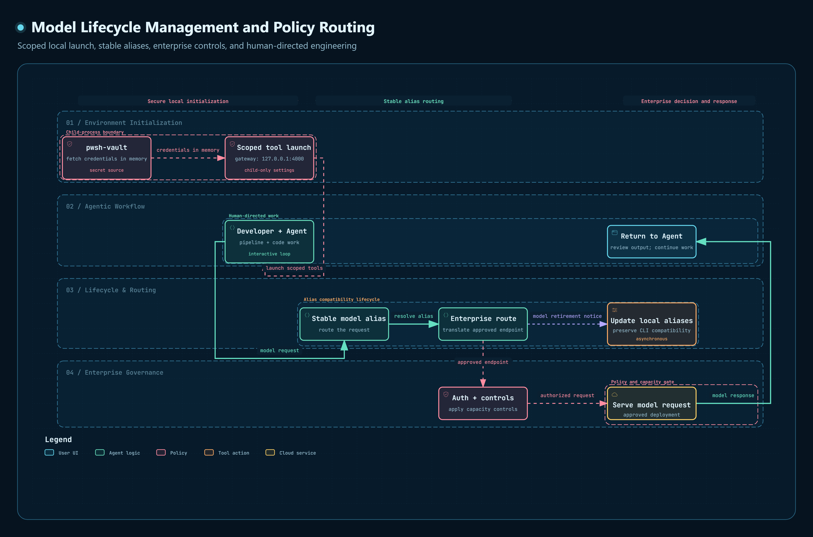

# Hi there, I'm Samuel N'tsua

### Data Engineer | Data Architecture, Microsoft Fabric & Analytical Productionization

I am a Data Engineer working at the intersection of data architecture,
cloud platforms, applied economics, and engineering automation. I design
reliable data systems that transform complex analytical requirements into
scalable, production-ready pipelines and governed data products.

My background in economics, econometrics, and survey methodology gives me
an uncommon perspective on data engineering. I understand not only how
data should be ingested, modeled, and transformed, but also how definitions,
statistical assumptions, revisions, lineage, and methodological decisions
affect downstream analysis.

My current work focuses on Microsoft Fabric, OneLake, Lakehouse
architecture, Delta tables, and medallion-pattern transformations. I build
reusable ingestion and transformation frameworks, automate macroeconomic
and survey-data workflows, and help move analytical models from exploratory
environments into maintainable production pipelines.

I approach engineering with an emphasis on reproducibility, idempotency,
observability, dependency control, and clear operational handoffs. My goal
is not simply to make a pipeline run, but to make it understandable,
testable, recoverable, and safe for others to operate.

---

## Core Capabilities

### Data Architecture

- Lakehouse and medallion architectures
- Analytical and dimensional data modeling
- Metadata-driven ingestion and transformation
- Schema management and data-contract validation
- Data lineage and reproducible processing
- Reusable data-framework design

### Microsoft Data Platform

- Microsoft Fabric
- OneLake
- Fabric Lakehouse
- Delta tables
- Data Factory pipelines
- Fabric notebooks
- Cloud and platform migration

### Data Engineering

- PySpark and Apache Spark
- SQL
- DuckDB
- Polars
- PyArrow
- Pandas
- Batch-processing pipelines
- Data-quality validation
- Large-scale data transformation

### Engineering Automation and DevOps

- Python
- PowerShell 7
- Bash
- Docker
- WSL2
- Git
- Environment and dependency management
- Structured logging
- Idempotent workflow design
- Automated preflight validation

### Economics and Analytics

- Macroeconomic data
- Econometrics
- Survey methodology
- Time-series analysis
- ARMA models
- Fixed-effects models
- Stata
- Tableau

---

## Enterprise AI Gateway and Developer-Agent Integration

My work with AI extends beyond using generative-AI chat interfaces. I
configure and maintain the model-access layer through which developer-facing
AI tools connect to organizationally approved models.

The architecture connects custom organizational API Management endpoints
to a locally hosted LiteLLM gateway bound to `localhost:4000`. Compatible
coding agents and command-line tools are configured to use this gateway
instead of connecting directly to their default provider-hosted models.

This creates a consistent integration layer between local developer tools
and the organization's approved model deployments.

*Figure 1: AI Routing Architecture detailing the boundaries between the local developer environment, enterprise cloud, and remote model providers.*
 
### Integration Responsibilities
•	Configure custom API Management URLs, credentials, and model deployments
•	Configure and operate a locally bound LiteLLM gateway
•	Route supported coding agents through the local gateway
•	Replace direct provider access with approved enterprise model routes
•	Normalize provider-specific deployments behind stable model aliases
•	Configure tool-specific base URLs, model names, and environment variables
•	Maintain compatibility across Copilot, Claude Code, Codex, and other tools
•	Update routes as the organization introduces or retires model deployments
•	Validate authentication, endpoint availability, and model compatibility
•	Separate infrastructure configuration from conversational AI usage

---

## Credential Security and PowerShell Environment Integration

Gateway credentials are not stored directly in scripts or PowerShell profile files.
Secrets are stored in a PowerShell SecretManagement-compatible vault and retrieved when the developer environment is initialized.

My PowerShell `$PROFILE` serves as a controlled developer-environment initialization layer.
Profile functions and aliases prepare supported tools with the appropriate LiteLLM gateway URL, authentication credential, enterprise model alias, tool-specific environment variables, and startup arguments.

This allows commands such as copilot, claude, or codex to initialize with approved gateway settings rather than silently falling back to each tool's default provider configuration. (Names such as copilot may represent locally defined PowerShell aliases or wrapper functions, not necessarily the official product name).

*Figure 2: Secure Initialization Sequence demonstrating how `$PROFILE.CurrentUserAllHosts` fetches credentials dynamically and scopes them to the agent.*

### The initialization layer is responsible for:
•	Retrieving credentials from the configured vault
•	Providing credentials to the appropriate local process
•	Setting tool-specific environment variables
•	Avoiding hard-coded secrets in reusable scripts
•	Limiting unnecessary exposure of gateway credentials
•	Separating secret storage from routing configuration
•	Validation and diagnostic behavior

---

## Model Lifecycle Management

The configuration must evolve as the organization's model catalog changes. Stable aliases reduce disruption to downstream tools. A coding agent can continue using a consistent local model name even when the underlying organizational deployment, API version, or provider changes.

*Figure 3: Model Lifecycle Workflow highlighting stable alias translation and policy enforcement without disrupting the agentic loop.*

### Lifecycle responsibilities include:
1.	Identifying newly available model deployments
2.	Validating endpoints and authentication
3.	Testing model compatibility through LiteLLM
4.	Creating or updating stable local aliases
5.	Updating tool-specific routing configuration
6.	Migrating tools away from superseded deployments
7.	Retiring obsolete mappings
8.	Verifying that default-provider fallbacks have not been reintroduced
9.	Documenting the resulting configuration
10.	Preserving a recoverable previous state when practical

---

## Applied AI and Agentic Development

AI platform integration is distinct from the way I use AI after the access layer has been configured.

I use conversational and agentic tools to support:
•	Technical research
•	Code development and review
•	Repository analysis
•	Pipeline troubleshooting
•	Documentation
•	Dependency investigation
•	Workflow prototyping
•	Configuration analysis
•	Engineering knowledge capture
•	Developer productivity

This distinction matters:
•	Conversational AI provides an interactive interface for questions, analysis, drafting, and exploration.
•	Agentic development tools interact more directly with repositories, terminals, files, and engineering workflows.
•	AI platform integration controls how those tools authenticate, route requests, select models, and connect to enterprise infrastructure.
•	AI model lifecycle engineering keeps those integrations functional as approved endpoints and model deployments change.

My capability spans these layers, but the gateway, security, routing, and lifecycle work is engineering infrastructure rather than ordinary chatbot usage.